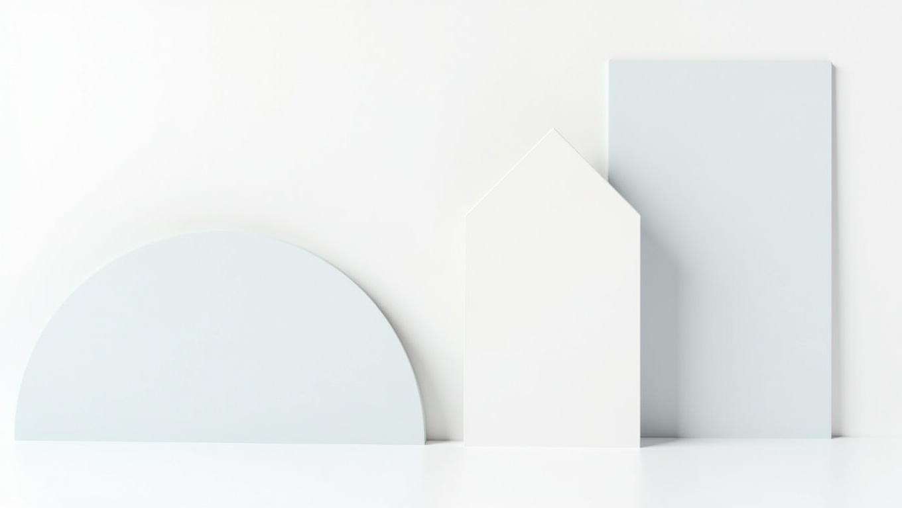
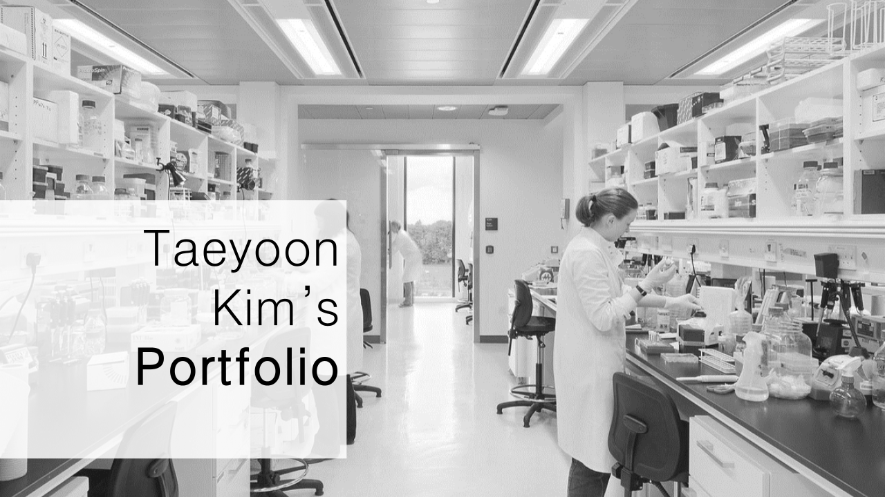
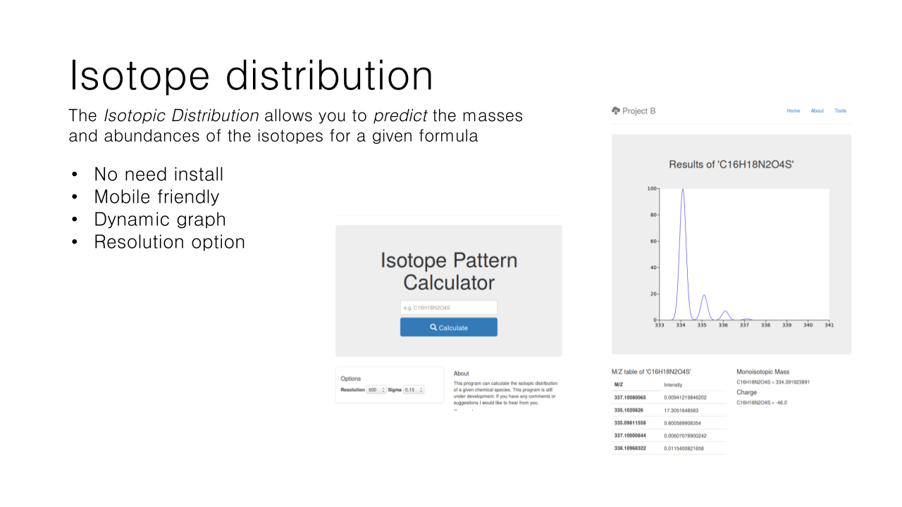
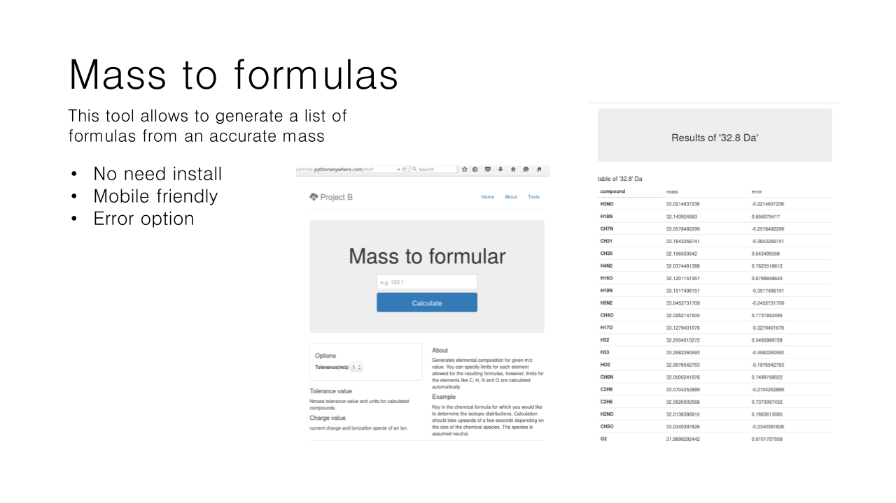
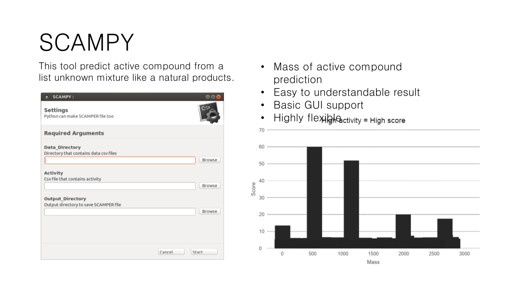
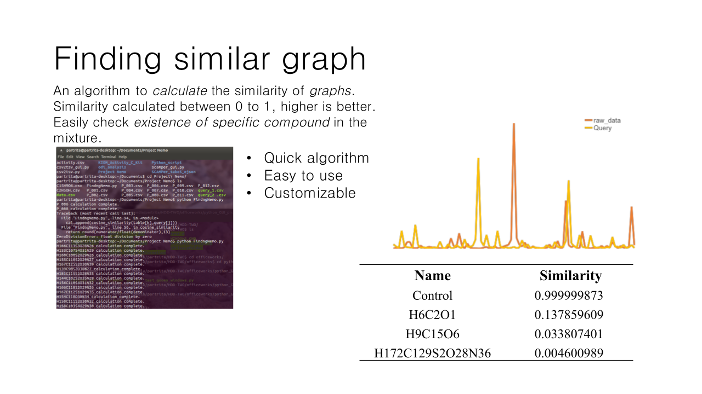

{width=80% fig-align="center"}

# 2015년 이전의 작업물 아카이브

2015년 이전에 개인적으로 진행했던 초기 웹 디자인, 사용자 인터페이스(UI), 그래픽 작업 및 프로젝트 기록들을 모아둔 공간입니다.

컴퓨터 과학과 생물정보학 연구로 본격적인 전환을 이루기 전, 다양한 시각적 시도와 인터랙션 설계를 실험했던 초기 여정의 결과물들입니다.

## 주요 작업 갤러리

### 1. 웹 인터페이스 및 프로젝트 디자인

{width=80% fig-align="center"}

초기 웹 서비스 인터페이스 및 브랜딩을 위해 디자인한 레이아웃 작업물입니다. 간결한 정보 배치와 타이포그래피 구성을 실험했습니다.

### 2. 인포그래픽 및 시각 자료

{width=80% fig-align="center"}

복잡한 개념을 시각적으로 구조화하여 전달하기 위한 인포그래픽 및 다이어그램 작업물입니다.

### 3. 애플리케이션 및 모바일 UI

{width=80% fig-align="center"}

스크린 기반 기기를 위한 사용자 경험(UX) 및 모바일 레이아웃 시안입니다. 사용자의 직관적인 조작 동선을 고려하여 설계했습니다.

### 4. 브랜딩 및 그래픽 요소

{width=80% fig-align="center"}

프로젝트 아이덴티티를 확립하기 위해 제작했던 그래픽 디자인과 아이콘 세트 구성입니다.

### 5. 종합 프로젝트 포트폴리오

{width=80% fig-align="center"}

다양한 디자인 에셋과 결과물들을 종합하여 구성했던 초기 포트폴리오 요약 페이지입니다.

## 회고

이 시기의 다양한 시각 디자인과 인터랙션 프로토타이핑 경험은 현재 복잡한 생물학적 구조 데이터와 고차원 유전체 데이터를 직관적으로 시각화하고 웹 기반 연구 도구를 설계하는 데 든든한 밑거름이 되고 있습니다.
