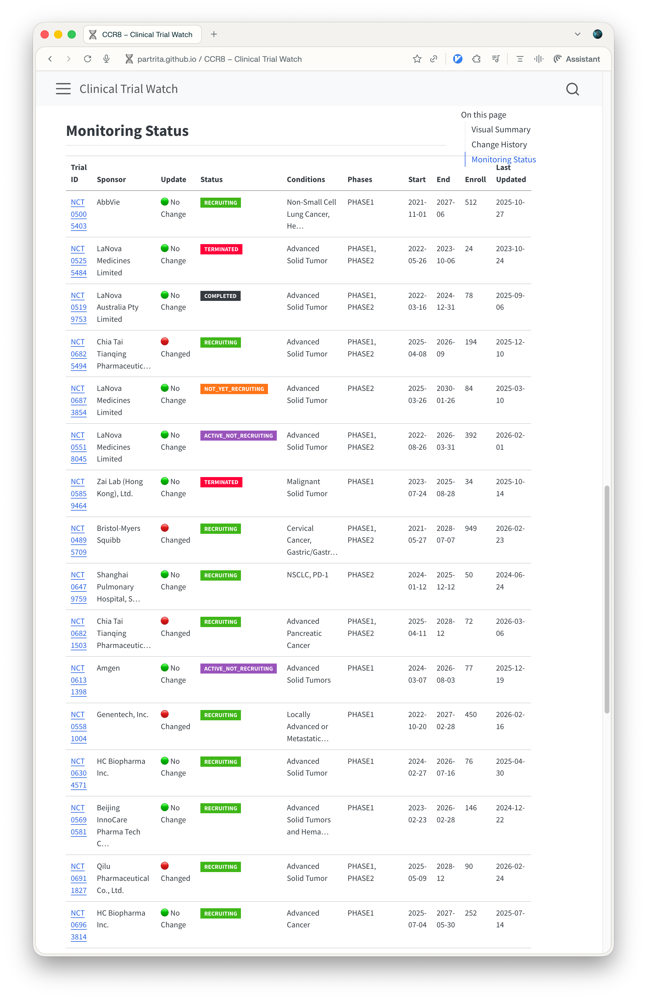
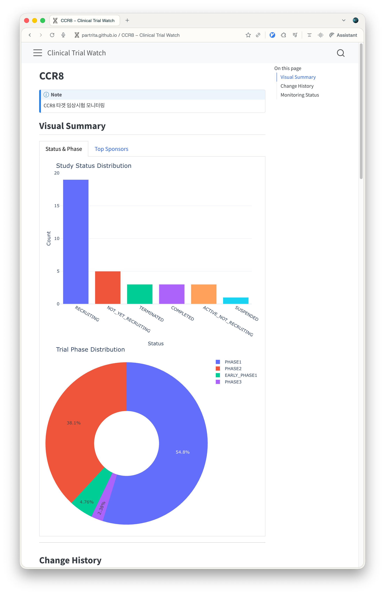

{width=80% fig-align="center"}

[clinical trial watcher](https://github.com/partrita/clinical-trial-watcher)는 미국 국립보건원(NIH)의 ClinicalTrials.gov에 등록된 글로벌 임상시험 정보를 수집하고 추적하기 위해 개발한 파이썬 기반의 프로젝트입니다.

# 프로젝트 배경

신약 개발 및 바이오 연구 분야에서는 특정 질환이나 약물 타깃 단백질에 대한 임상시험 진행 상황을 지속적으로 파악하는 것이 중요합니다. 하지만 ClinicalTrials.gov 웹사이트를 매번 수동으로 검색하고 변경된 내용을 일일이 대조하는 작업은 번거롭고 누락이 발생하기 쉽습니다. 이러한 문제를 해결하고자 관심 질환이나 타깃 유전자에 대한 임상시험 데이터를 자동으로 수집하고 변동 사항을 한눈에 식별할 수 있는 모니터링 도구를 구현했습니다.

## 주요 기능

1. 관심 질환 및 타깃별 임상시험 자동 검색
ClinicalTrials.gov의 공식 REST API를 활용하여 연구자가 사전에 설정한 질병명, 유전자 타깃, 약물 후보물질 키워드를 기반으로 관련 임상시험 목록을 수집합니다.

2. 임상시험 상태 및 단계별 분류
수집된 임상시험들을 임상 단계(Phase 1, 2, 3, 4)와 환자 모집 현황(Recruiting, Active, Completed 등)별로 체계적으로 분류하여 연구 파이프라인의 전반적인 성숙도를 파악할 수 있습니다.

3. 실시간 변경 감지 및 상태 뱃지 시각화
주기적인 API 호출을 통해 각 임상시험의 최종 갱신일을 추적합니다. 최근 한 달 이내에 프로토콜이나 모집 상태에 변동이 발생한 임상시험은 Update 표시등이 초록색에서 붉은색으로 바뀌어 사용자가 변경 사항을 즉시 알아차릴 수 있습니다.

4. 세부 변경 이력(History) 추적
임상시험 계획서의 수정, 환자 수 변경, 임상 단계 변경 등 과거 변경 내역을 기록하여 타깃 파이프라인의 진척 과정을 시간 순서대로 검토할 수 있습니다.

## 스크린샷

::: {layout-ncol=2}
{width=100%}
{width=100%}
:::

위 화면과 같이 웹 인터페이스를 통해 등록된 임상시험 목록과 각 연구의 현재 상태, 타깃 질환, 최근 업데이트 여부를 직관적으로 확인할 수 있습니다.

## 시스템 아키텍처 및 기술 스택

- 개발 언어: Python 3.10 이상
- 데이터 소스: ClinicalTrials.gov REST API
- 데이터 처리: Pandas, Requests
- 자동화 및 스케줄링: GitHub Actions를 통한 일일 정기 크롤링 및 상태 갱신
- 결과 제공: 정적 웹 대시보드 연동을 통한 경량 뷰어 제공

## 기대 효과 및 활용 방안

- 바이오 벤처 및 제약사: 경쟁 파이프라인의 개발 속도와 임상 진행 상황 모니터링
- 임상 연구자 및 학계: 특정 바이오마커 관련 최신 임상 설계 및 프로토콜 트렌드 벤치마킹
- 신약 개발 프로젝트 기획: 미충족 의료 수요(Unmet Medical Needs) 및 미개척 임상 영역 탐색

# Repository

- [clinical trial watcher GitHub](https://github.com/partrita/clinical-trial-watcher)
