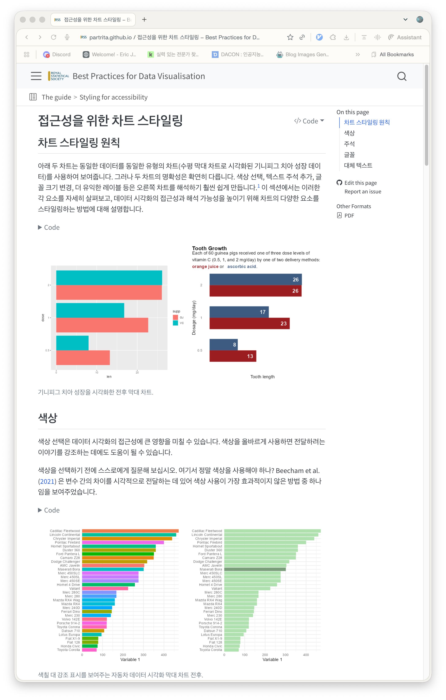

데이터 시각화 가이드 번역 프로젝트는 영국 왕립 통계 학회(Royal Statistical Society, RSS)에서 발간한 데이터 시각화 스타일 가이드를 한국어로 번역하고 웹 문서로 배포한 작업입니다.

# 가이드 개요

이 가이드는 데이터 시각화를 단순한 기술을 넘어 예술이자 과학의 융합으로 다룹니다. 원래는 통계 학회 간행물에 기여하는 통계학자와 기고가들을 위한 표준 지침으로 제작되었으나, 학술 논문, 비즈니스 리포트, 데이터 저널리즘 등 모든 시각화 작업에서 보편적으로 적용할 수 있는 훌륭한 통찰을 담고 있습니다.

데이터의 본질을 왜곡 없이 정확하게 전달하는 기본 원칙부터, 차트의 레이아웃 구성, 미학적 스타일링, 접근성 보장, 그리고 목적에 부합하는 적절한 차트 유형 선택법까지 구체적인 예시와 함께 정리되어 있습니다.

## 핵심 가이드라인 요약

1. 데이터 전달의 정직성과 명확성
데이터의 축(Axis) 왜곡, 3D 차트 사용에 따른 착시, 불필요한 장식 요소(Chartjunk)를 배제하고 데이터 자체가 주인공이 되도록 설계합니다.

2. 시각적 계층 구조(Visual Hierarchy)
제목, 부제, 라벨, 주석의 서체 크기와 여백을 체계적으로 구성하여 독자가 핵심 메시지를 직관적으로 파악할 수 있도록 돕습니다.

3. 색상 선택과 접근성(Accessibility)
색각 이상자(색맹, 색약)를 배려한 배색 규칙을 제안하며, 흑백 인쇄나 저해상도 화면에서도 정보의 구분이 명확하게 유지되도록 가이드를 제공합니다.

4. 목적별 차트 선택 가이드
수치 비교, 분포 탐색, 상관관계 분석, 시계열 추이 관찰, 비율 구성 등 전달하고자 하는 데이터의 구조에 최적화된 차트 유형을 명확히 제시합니다.

## 번역 및 배포 목적

국내 데이터 과학자, 생물정보학 연구자, 분석가들이 학술 논문이나 보고서를 작성할 때 참고할 수 있는 체계적인 한국어 레퍼런스를 제공하고자 했습니다. 다양한 참고 문헌과 실무 예시가 함께 수록되어 있어 데이터 시각화 역량을 한 단계 높이고자 하는 분들에게 실질적인 도움이 됩니다.

# 온라인 가이드 읽기

- [데이터 시각화 가이드 한국어 웹사이트](https://partrita.github.io/datavisguide/)

# Repository

- [datavisguide GitHub](https://github.com/partrita/datavisguide)
