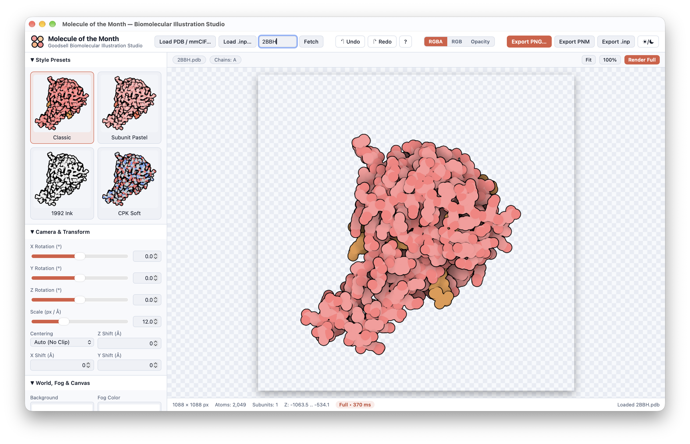

단백질 구조 논문이나 [Molecule of the Month](https://pdb101.rcsb.org/motm/motm-about)에서 한 번쯤 봤을 법한, 수채화처럼 부드럽고 뚜렷한 외곽선을 가진 생체분자 일러스트가 있습니다. David S. Goodsell 교수팀이 공개한 [`Illustrate`](https://github.com/ccsb-scripps/Illustrate)가 바로 이 스타일의 원조 도구입니다.

문제는 원래 코드가 Fortran 77(`legacy/illustrate.f`)로 작성되어 있고, `.inp` 스크립트를 직접 손으로 작성하고 CLI로 실행해야 한다는 점이었습니다. 저는 포트란 코드를 읽을 줄 모르기 때문에  Vibe Coding으로 이 도구를 Rust와 데스크톱 GUI 앱으로 옮겨 보기로 했습니다.

> 포트란 코드를 한 줄도 읽지 못해도, 검증 가능한 기준(픽셀 파리티 테스트)과 AI 페어 프로그래밍만 있으면 30년 된 과학 계산 도구를 현대적인 크로스 플랫폼 데스크톱 앱으로 되살릴 수 있었습니다.

## 포트란을 못 읽는데 어떻게 똑같이 옮겼을까?

포트란 문법이나 1990년대식 고정 컬럼 입출력 규칙을 몰라도, "원본과 결과가 똑같은가"를 자동으로 검증할 장치가 있으면 안전하게 코드를 옮길 수 있습니다.

이 프로젝트에서는 `tests/parity_2hhb.rs`에 기준 테스트를 먼저 세웠습니다.

1. `gfortran -finit-local-zero legacy/illustrate.f`로 원본 포트란 바이너리를 컴파일합니다.
2. 표준 헤모글로빈 예제(`examples/2hhb.inp`, `examples/2hhb.pdb`)를 원본과 Rust 버전에 각각 통과시킵니다.
3. 생성된 Netpbm `P3` 파일(`2hhb.pnm`, `opacity.pnm`)을 비교해 0 픽셀 차이, 바이트 단위 동일을 통과 조건으로 걸었습니다.

덕분에 `f32` 단정밀도 연산이나 `LEGACY_PI = 3.141592` 같은 미세한 수치 습관, 3×3 윤곽선 커널의 경계 처리처럼 사람 눈으로 찾기 까다로운 부분도 원본과 어긋나지 않게 유지할 수 있었습니다.

또한 CLI와 렌더링 엔진은 루트 크레이트(`illustrate`)에 순수 라이브러리로 두고, GUI는 별도의 크레이트(`crates/illustrate-gui`)로 분리해 `#![forbid(unsafe_code)]` 아래에서 관리했습니다.

## 텍스트 스크립트에서 Tauri v2 데스크톱 앱으로

원작은 `.inp` 텍스트 파일에서 회전 각도, 스케일, 외곽선 파라미터를 고친 뒤 다시 실행해야 결과를 볼 수 있었습니다. 이를 마우스로 바로 만질 수 있도록 Tauri v2 기반의 데스크톱 앱(Molecule of the Month)으로 감쌌습니다.

프론트엔드(`crates/illustrate-gui/ui/`)는 Node.js나 번들러(Webpack/Vite) 없이 순수 HTML, CSS, Vanilla JS로만 구성해 `cargo build` 한 번으로 Linux, macOS, Windows에서 모두 빌드되도록 만들었습니다.

특히 마우스 드래그 중에는 그림을 빠르게 그리는 2단계 렌더링을 적용했습니다.

- 드래그/슬라이더 조작 중(`fast_preview = true`): 해상도를 낮추고 원뿔형 그림자(Conical Shadow) 계산을 꺼서 즉각 반응합니다.
- 마우스를 놓는 순간(`fast_preview = false`): `render_smooth` 경로로 전체 품질의 이미지를 다시 렌더링합니다.

## 다운로드 및 사용해 보기

GitHub Actions 릴리스 워크플로를 통해 macOS(Universal), Windows, Linux용 설치 파일과 실행 파일을 자동으로 빌드해 배포하고 있습니다.

- [GitHub 저장소](https://github.com/partrita/Illustrate-mom)
- [릴리스 다운로드](https://github.com/partrita/Illustrate-mom/releases)

