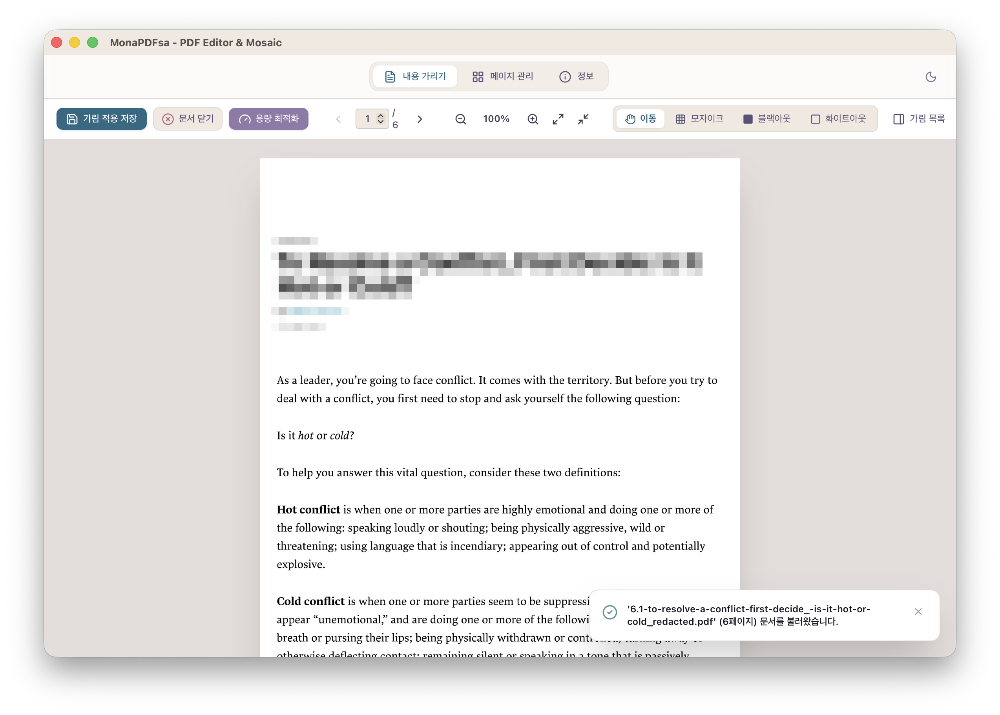
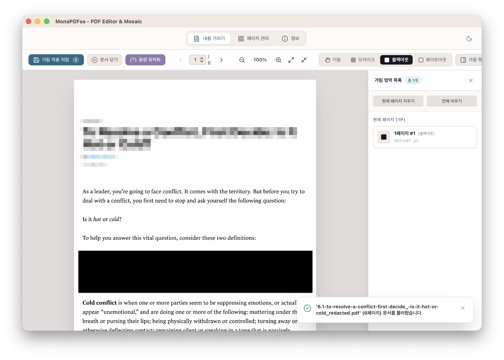
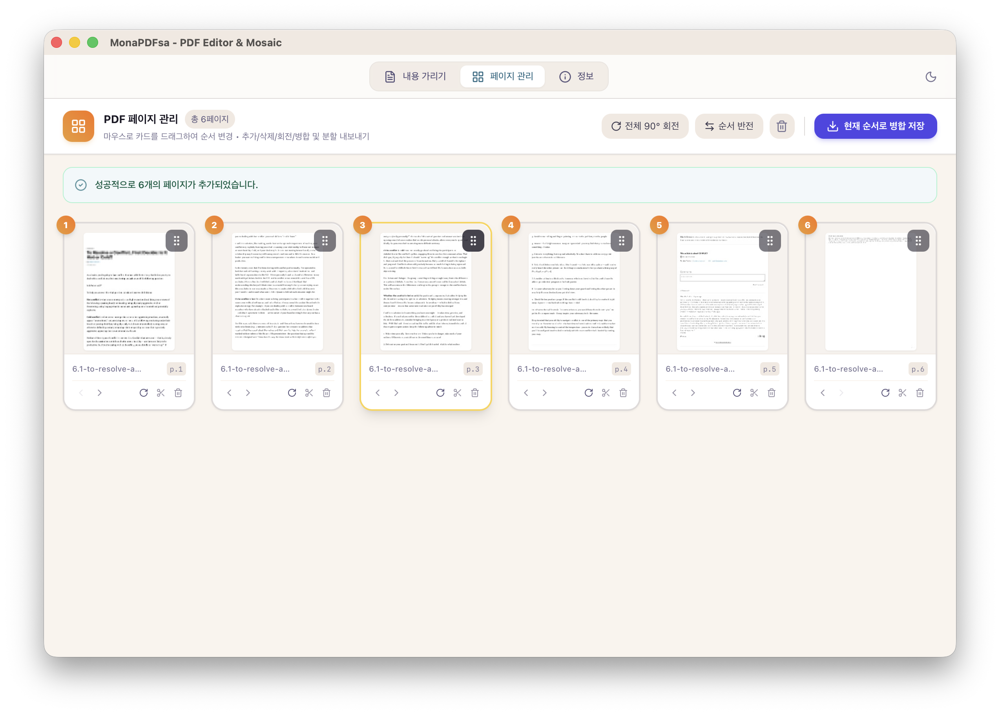
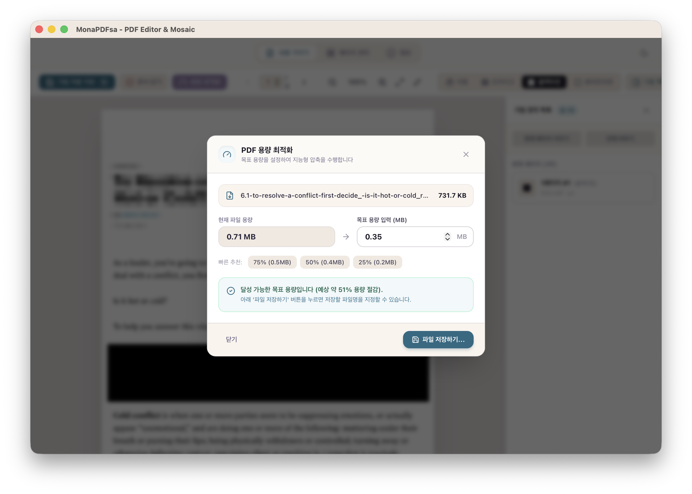

# MonaPDFsa

MonaPDFsa는 일상적인 업무와 연구 과정에서 꼭 필요한 최소한의 핵심 기능만을 담아 제작한 데스크톱 PDF 파일 편집 도구입니다. 완전히 무료이며 오픈소스로 공개되어 있습니다.

Rust 언어 기반의 Tauri v2 프레임워크와 React, TypeScript, Tailwind CSS를 결합하여 제작되었습니다. 기존의 무거운 일렉트론(Electron) 앱과 달리 매우 가볍고 빠르며, Windows, macOS, Linux 등 다양한 운영체제를 완벽하게 지원합니다.

# 개발 배경

연구 문서, 논문 초안, 개인 증빙 서류 등을 다룰 때 특정 개인정보나 민감한 연구 데이터를 가리거나 페이지를 병합해야 하는 경우가 자주 발생합니다. 대다수의 온라인 무료 PDF 도구들은 문서를 외부 서버로 업로드해야 하므로 중요한 기밀이나 개인정보 유출 위험이 존재합니다. 

MonaPDFsa는 외부 서버와 일체 통신하지 않고 사용자의 로컬 컴퓨터 내에서 모든 렌더링과 편집 연산을 완결하도록 설계하여 철저한 개인정보 보호와 보안성을 보장합니다.

## Screenshots

### 1. 모자이크 검열

위 그림은 모자이크 마스킹 모드를 보여줍니다. 문서 위에서 마우스로 영역을 드래그하면 해당 위치의 텍스트와 이미지가 픽셀 블록으로 흐림 처리됩니다. 상단 툴바를 통해 이동, 모자이크, 완전 검열(블랙아웃), 화이트아웃 처리를 자유롭게 전환할 수 있습니다.

### 2. 검열 박스 처리

검은색 혹은 흰색 상자로 가리고자 하는 영역을 완전히 덮어씌웁니다. 오른쪽 사이드바 패널에서는 생성된 모든 마스킹 목록이 페이지 번호, 마스킹 유형, 크기 좌표와 함께 일목요연하게 표시되어 수정 및 관리가 용이합니다.
 
### 3. 페이지 관리 및 재배열

문서의 각 페이지 썸네일을 시각적으로 보면서 마우스 드래그 앤 드롭으로 페이지 순서를 변경할 수 있습니다. 툴바의 아이콘을 클릭하여 특정 페이지를 90도 단위로 회전하거나, 불필요한 페이지를 삭제하거나, 별도의 파일로 분할 및 병합하여 저장할 수 있습니다.

### 4. 파일 크기 최적화

목표 파일 크기를 MB 단위로 설정하여 용량을 줄일 수 있습니다. 해상도와 압축률에 따라 75%, 50%, 25% 등의 직관적인 프리셋 옵션을 제공하여 대용량 PDF를 이메일 첨부나 웹 업로드 규격에 맞게 최적화합니다.

> 용량을 압축하면 이미지의 해상도 품질이 함께 조정되므로 용도에 맞는 적절한 프리셋을 선택하는 것이 권장됩니다.

## 주요 기술 스택

- 백엔드 런타임: Rust, Tauri v2
- 프론트엔드 프레임워크: React 18, TypeScript
- 스타일링: Tailwind CSS
- PDF 렌더링 엔진: PDF.js 기반 로컬 렌더링
- 지원 플랫폼: Windows, macOS, Linux

---

# Repository

- [MonaPDFsa GitHub 저장소](https://github.com/partrita/MonaPDFsa)
- [다운로드 릴리즈 페이지](https://github.com/partrita/MonaPDFsa/releases)
