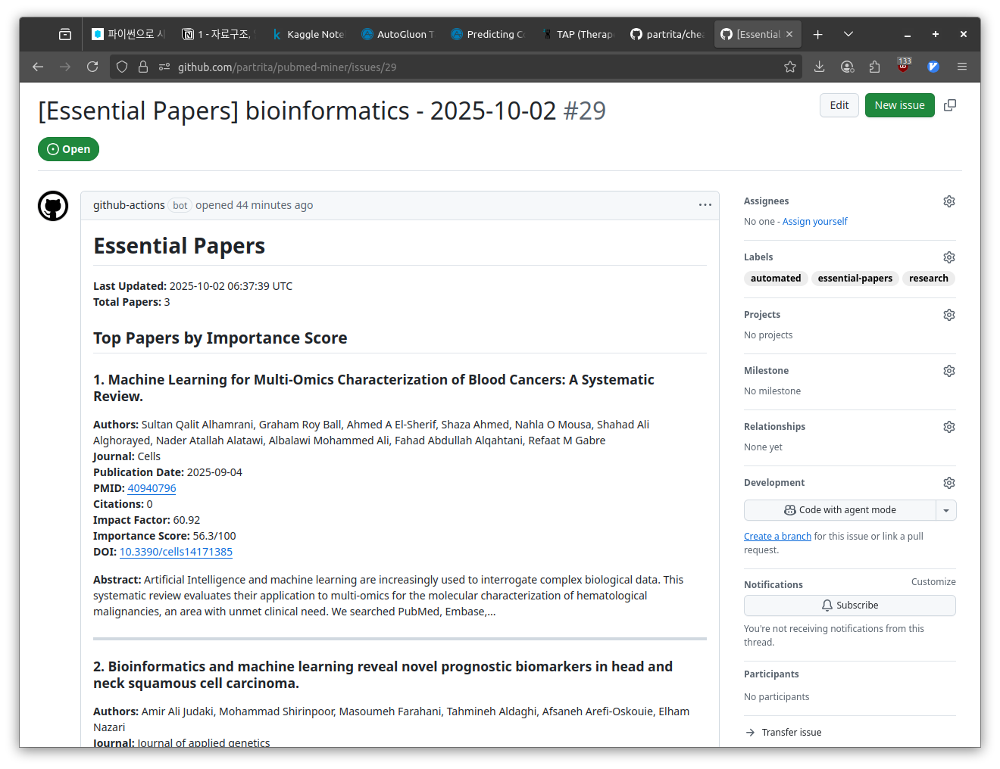

{width=80% fig-align="center"}

[pubmed-miner](https://github.com/partrita/pubmed-miner)는 미국 국립생물공학정보센터(NCBI)의 PubMed 데이터베이스에 등재된 방대한 의학 및 생명과학 논문 초록을 자동으로 수집하고 분석하기 위해 개발한 파이썬 기반의 텍스트 마이닝 프로젝트입니다.

# 프로젝트 배경

생명과학 분야에서는 매일 수천 편의 새로운 학술 논문이 출판되고 있습니다. 특정 유전자, 질병, 단백질에 대한 최신 연구 동향을 수작업으로 모두 읽고 정리하는 것은 사실상 불가능합니다. pubmed-miner는 자연어 처리와 네트워크 분석 기법을 결합하여, 연구자가 입력한 검색어와 연관된 문헌 데이터를 대규모로 수집하고 그 안에 숨겨진 생물학적 연결 고리를 빠르게 시각화할 수 있도록 돕습니다.

## 핵심 파이프라인

1. NCBI E-utilities 연동 및 초록 수집
NCBI의 공식 API인 E-utilities(ESearch, EFetch)를 연동하여 사용자가 정의한 복합 검색 쿼리에 부합하는 수천 건의 논문 메타데이터와 초록 전문을 신속하게 다운로드합니다.

2. 텍스트 정제 및 생물학적 개체명 추출
영문 불용어(Stopwords) 제거, 어간 추출, 구두점 정제 과정을 거친 뒤 문헌 내에서 반복적으로 등장하는 주요 유전자, 단백질, 질환, 약물 명칭을 토큰화합니다.

3. 동시 출현(Co-occurrence) 네트워크 분석
동일한 논문 초록에서 두 개체명이 함께 언급된 빈도를 기반으로 가중치 그래프를 구축합니다. 이를 통해 특정 표적 단백질과 유의미하게 연관된 신호 전달 경로 및 동반 질환 후보군을 클러스터링합니다.

4. 연도별 연구 트렌드 추이 시각화
연도별 출판 논문 수와 주요 키워드의 빈도 변화를 시계열 그래프로 나타내어, 특정 학술 주제가 최근 주목받고 있는지 혹은 쇠퇴하고 있는지를 한눈에 보여줍니다.

## 프로젝트의 활용법

`pubmed-miner` 프로젝트는 다음과 같은 연구 및 실무 상황에서 유용하게 활용될 수 있습니다.

- 특정 주제 연구 동향 파악: 특정 질병이나 유전자에 대한 최신 연구 동향을 빠르게 파악하고 싶을 때, 관련 논문들에서 언급된 주요 생물학적 개체들을 한눈에 확인할 수 있습니다.
- 대규모 문헌 스크리닝: 수백, 수천 편의 논문을 사람이 직접 읽지 않고도, 기계적인 방법을 통해 원하는 정보(예: 특정 단백질과 관련된 질병)를 빠르게 스크리닝할 수 있습니다.
- 신규 연구 가설 수립: 서로 다른 맥락에서 보고된 바이오마커 사이의 숨겨진 상관관계를 네트워크 구조로 발견하여 후속 실험 설계를 가속합니다.

## 기술 스택

- 언어: Python 3.10 이상
- 문헌 데이터 API: Biopython (Bio.Entrez) 및 NCBI E-utilities
- 데이터 처리 및 분석: Pandas, NumPy
- 네트워크 모델링: NetworkX
- 시각화: Matplotlib, Seaborn

# Repository

- [pubmed-miner GitHub](https://github.com/partrita/pubmed-miner)
