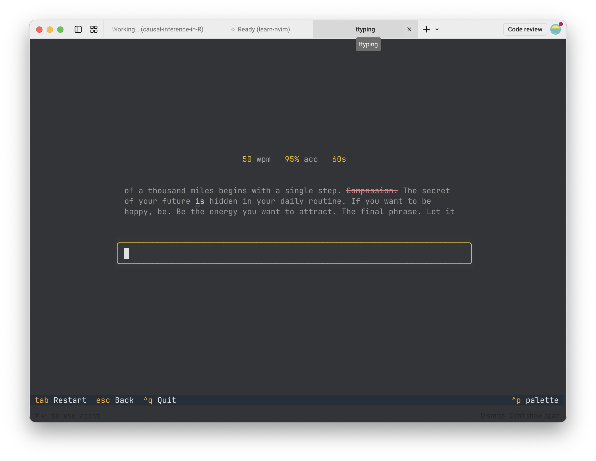

# ttyping ⌨️



다양한 타이핑 연습 사이트들이 존재하지만, 개발자로서 터미널 창을 벗어나지 않고 가볍고 집중도 높게 연습할 수 있는 도구를 원해 직접 바이브 코딩(Vibe Coding)으로 개발하게 되었습니다.

영어와 한국어 입력을 모두 지원하는 미니멀한 터미널 기반 타이핑 테스트 프로그램으로, Python과 최신 TUI 프레임워크인 [Textual](https://github.com/Textualize/textual)을 활용하여 제작되었습니다.

`ttyping`은 브라우저를 띄울 필요 없이 터미널 화면 안에서 즉시 깔끔하고 몰입감 넘치는 타이핑 환경을 제공합니다. 타이핑 속도(WPM, CPM)와 정확도를 정밀하게 측정하고 그 결과를 로컬 저장소에 체계적으로 기록합니다.

## ✨ Features

- 다국어 및 다양한 자판 배열 지원: 영문(Qwerty, Dvorak, Colemak)뿐만 아니라 한국어(2벌식, 3벌식) 연습을 완벽히 지원합니다.
- 손가락별 집중 연습: 특정 손가락 그룹에 배정된 키들만 모아 훈련하여 키보드 근육 기억을 효과적으로 향상시킵니다.
- 정확도 중심 모드: 설정한 목표 정확도에 미달하거나 오타가 발생했을 때 즉시 단계를 재시작하는 집중 훈련 모드를 제공합니다.
- 로컬 통계 누적: 연습 일자별 속도(WPM)와 정확도 기록이 로컬 JSON 파일에 저장되어 실력 향상 추이를 추적할 수 있습니다.
- 단축키 기반 인터페이스: 마우스 없이 Tab 키를 눌러 즉시 테스트를 다시 시작하고, Esc 키로 간편하게 설정을 전환할 수 있습니다.

## 🚀 Installation

`uv` 패키지 관리자를 사용하여 설치하는 것을 권장합니다:

```bash
uv tool install ttyping
```

## 🎮 Usage

설치 후 터미널 어디서나 다음 명령어로 즉시 실행할 수 있습니다:

```bash
uvx ttyping
```

또는 직접 설치된 환경에서 다음 명령어를 입력합니다:

```bash
ttyping
```

## 🛠️ Tech Stack

- 언어: Python 3.10 이상
- TUI 프레임워크: [Textual](https://github.com/Textualize/textual)
- 터미널 서식 및 텍스트 렌더링: [Rich](https://github.com/Textualize/rich)
- 데이터 저장 위치: `~/.ttyping/results.json`

## 코드 저장소

- [ttyping GitHub](https://github.com/partrita/ttyping)
- [ttyping 웹 문서](https://partrita.github.io/ttyping)
