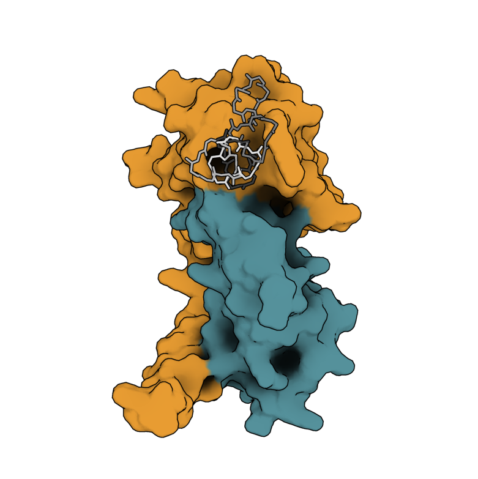
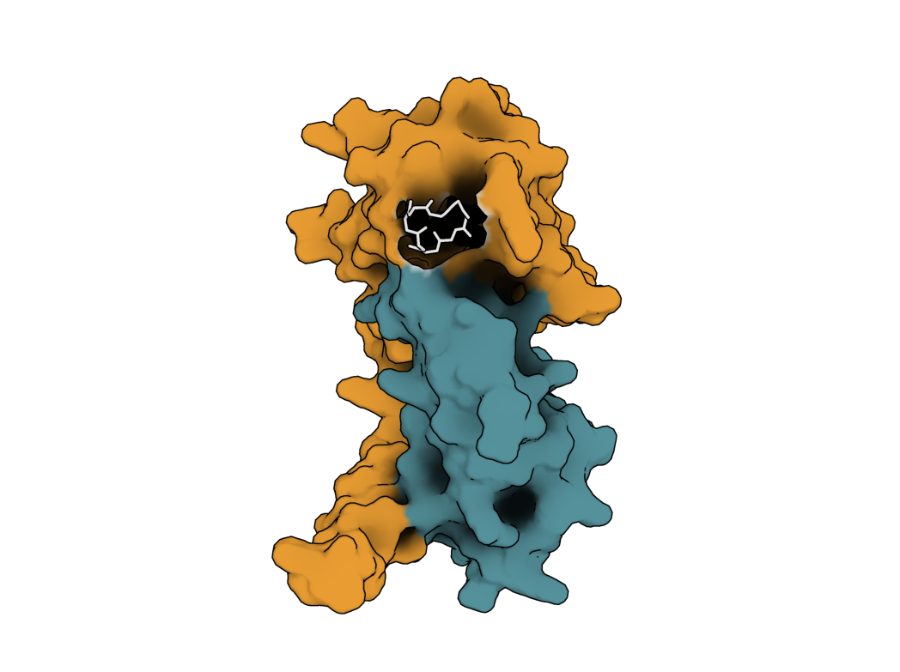

PXDesign(Protenix Design)은 확산 모델(Diffusion Model) 기반의 딥러닝 단백질 바인더 디자인 도구입니다. 다만 기존 PXDesign은 주로 선형(linear)의 단백질 혹은 펩타이드 바인더 생성 옵션만 제공합니다.

본 포스팅에서는 Head-to-Tail 환형 펩타이드를 직접 설계할 수 있도록 PXDesign 코드를 일부 수정하고 이를 통해 신생아 Fc 수용체(FcRn, Neonatal Fc Receptor) 표적 환형 펩타이드 바인더를 디자인해봅니다.

## 주요 코드 수정 사항

원형 결합 구조를 모델이 올바르게 인식하고 평가할 수 있도록 데이터 파이프라인, 상대 위치 인코딩, 평가 모듈 전반을 수정했습니다.

### 1. Head-to-Tail 공유결합 정의

환형 펩타이드는 첫 번째 잔기(N-말단)와 마지막 잔기(C-말단)가 펩타이드 결합으로 연결되어야 합니다. YAML 설정의 `cyclic: true` 플래그를 인식하여, 바인더 체인의 1번 위치(N)와 $L$번 위치(C) 간의 공유결합(`covalent_bonds`) 정보 및 마스크 텐서(`is_cyclic_mask`)를 데이터 파이프라인에서 자동으로 생성해 모델에 주입합니다.

### 2. 원형 상대 위치 인코딩

선형 펩타이드와 달리 환형 펩타이드에서는 1번 잔기와 $L$번 잔기가 바로 인접해 있습니다. 기존 선형 상대 위치 인코딩 대신 원형 상의 최단 거리(circular offset)를 반영하도록 임베딩 로직을 수정했습니다:

$$d_{\text{cyclic}}(i, j) = \left( (i - j + \lfloor L/2 \rfloor) \pmod L \right) - \lfloor L/2 \rfloor$$

이를 통해 모델의 Diffusion 백본이 잔기 간의 순환적 연결성을 올바르게 반영하여 디노이징을 수행합니다.

### 3. 평가 파이프라인에 연동

생성된 후보군의 구조적 타당성을 검증하는 AlphaFold2 및 Protenix(PTX) 필터에 `cyclic: true` 설정이 전달되도록 연결하여, 평가 도구에서도 환형 펩타이드 옵션이 자동으로 활성화되도록 구현했습니다.

## Cyclic Peptide 디자인하기

다음은 FcRn(PDB: 3M17)을 표적으로 하는 8-mer 환형 펩타이드를 설계하는 과정입니다.

### 1. 리포지토리 클론 및 환경 설정

```bash
git clone https://github.com/partrita/PXDesign.git
cd PXDesign

# 의존성 및 빌드 환경 자동 설치
bash install.sh

# 환경 정상 설치 확인
pixi run test
```

> `[OK] All modules imported successfully!` 및 GPU 장치 활성화 메시지가 출력되면 준비가 완료된 것입니다.

### 2. 사전 학습 모델 가중치 다운로드

바인더 생성(Diffusion) 및 평가(AF2, PTX)에 필요한 가중치를 다운로드합니다:

```bash
bash download_tool_weights.sh
```

### 3. 디자인 설정 (`examples/FcRn_cyclic_peptide.yaml`)

> 사전에 FcRn-IgG1 의 결합에 중요하다고 알려진 아미노산 위치를 찾았습니다(117, 132, 137).

FcRn 복합체 구조(`3m17.cif`)의 체인 A 결합 핫스팟(117, 132, 137)을 지정하고, 8개 잔기 길이의 환형 펩타이드를 설계하도록 구성합니다.

```yaml
task_name: FcRn_cyclic_peptide_binder
target:
  file: ./examples/3m17.cif
  chains:
    A:
      crop:
        - 5-200
      hotspots:
        - 117
        - 132
        - 137
      msa: ./msa_cache/20261016_85c7c1/0
    B: all
binder_length: 8
cyclic: true
```

### 4. 파이프라인 실행

```bash
pixi run pxdesign pipeline \
  -i examples/FcRn_cyclic_peptide.yaml \
  -o ./examples/fcrn_run \
  --N_sample 5 \
  --N_step 400 \
  --dtype bf16
```

#### 옵션 설명

- `-i`: 디자인 설정 파일 경로 (`.yaml` 또는 `.json`)
- `-o`: 결과 출력 디렉토리
- `--N_sample`: 생성할 바인더 후보 수
- `--N_step`: 확산 모델 디노이징 스텝 수 (기본은 400)
- `--dtype`: 계산 정밀도 (`bf16` 또는 `fp32`)

## 결과 확인

파이프라인이 완료되면 `./examples/fcrn_run` 디렉토리에 다음 결과물이 생성됩니다:

- `design_outputs/`: 생성된 후보 구조 파일 (`orig_designed/rank_*.cif`)
- `seed_*/predictions/sample_level_output.csv`: RMSD, i_pAE, pLDDT 등 평가 지표
- `target_pred/`: 타깃-바인더 복합체 예측 구조

생성된 구조를 시각화 도구(PyMOL 등)로 확인하면 N-말단과 C-말단이 원형으로 연결되어 FcRn 표면 핫스팟(Arg117, Trp132 등)에 결합하는 포즈를 확인할 수 있습니다. 제가 한 결과를 PyMoL로 확인해 보니 아래와 같습니다.



위 이미지에서 표현되어 있듯이, 흰색으로 표시된 펩타이드가 의도한 위치에 정확하게 결합하는 것을 확인할 수 있었습니다.

## 마치며

이번 경험을 통해 PXDesign의 강력한 Diffusion 백본과 필터링 파이프라인을 그대로 활용하면서 Head-to-tail cyclic peptide를 직접 설계해보았습니다. 결과를 살펴보니 cyclic이 아니거나 엉뚱한 위치에 결합하는 녀석도 있었습니다. 추후에는 이런 것을 미리 필터링해서 결과에서 제거하는 단계가 필요할 것 같네요.

상세 소스코드와 구현 내역은 [partrita/PXDesign GitHub](https://github.com/partrita/PXDesign)에서 확인하실 수 있습니다.
